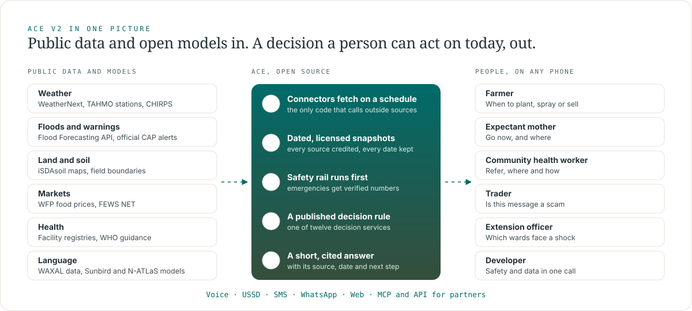

# ACE: the African Context Engine

[](https://github.com/tbrunoh/african-context-engine/actions/workflows/ci.yml)
[](LICENSE)
[](pyproject.toml)
[](DATA_LICENSE.md)
[](docs/architecture.md#mcp)

**Checked, local, citable knowledge for Africa, on any phone.**

ACE answers the questions that matter to people who will never install an app: a farmer whose maize is being eaten, a pregnant woman who is bleeding, a mother who just got an M-PESA message that feels wrong. It answers on USSD, SMS, voice, WhatsApp and the web, in English, Swahili and French, across 13 African countries, and every answer points to the published source it came from. It runs with no language model and no API key. When you do plug in a model, ACE checks that the model stayed with the facts and falls back when it did not.

```
$ ace ask "viwavi wanakula mahindi yangu nifanye nini" --channel sms
Ponda mayai na viwavi wachanga kwa mkono. Inafaa sana kwa mashamba madogo. Dalili: madoa kama madirisha
kwenye majani, kilele kilicholiwa, kinyesi kibichi kama unga wa mbao.

Sources:
  [sourced] FAO, Fall armyworm management guidance for smallholders
      https://openknowledge.fao.org/server/api/core/bitstreams/f1e28a46-3822-4c03-bc31-4294e7e83ea1/content
  [sourced] ICIPE, Fall armyworm identification, management and control; CIFOR-ICRAF, Fall Armyworm guide
      https://technologytransfer.icipe.org/wp-content/uploads/2021/04/Fall-Armyworm-Brochure-Identification-Management-and-Control-1.pdf
```

## Why ACE exists

- About 1 billion Africans live inside mobile broadband coverage but do not use mobile internet (GSMA, Mobile Economy Africa 2026). USSD, SMS and voice still reach them.
- AI advisory services are proving demand: Digital Green's FarmerChat reaches nearly 3 million farmers, Jacaranda Health's PROMPTS has reached more than 3.8 million mothers in Kenya, and MTN Rwanda's voice AI, Miss Baza, has reached more than 500,000 users on a basic phone call. Each one rebuilds its own knowledge base, channel stack and safety layer, and the knowledge stays locked inside.
- African language models are arriving (InkubaLM, Sunflower), but a model does not know which hotline handles gender based violence in Kenya or what moisture level keeps maize free of aflatoxin. Models need grounding.

ACE is the shared layer underneath: open knowledge packs anyone can load, a channel toolkit for the phones people actually use, and a safety rail that runs before anything else. The full competitive map is in [docs/landscape.md](docs/landscape.md).

## What V1 does

| Capability | What it means for a person | Where |
|:--|:--|:--|
| **13 countries, one engine** | The caller's dialling code picks the country, so the numbers, topics and default language are always right for that person | `countries.py`, `engine.py` |
| **Grounded answers** | Short, practical answers in English, Swahili or French, each traced to a published source | `engine.py`, `context/` |
| **Safety rail** | Emergency language in English, Swahili or French gets that country's verified numbers at once and a human handoff, before retrieval or any model. ACE never gives a number from another country | `safety.py` |
| **Scam Shield** | Forward a suspicious mobile money message in English, Swahili or French and get an explained verdict. In Kenya it cites Safaricom's own guidance; elsewhere it gives no number it cannot cite. It never calls a message safe | `scam.py` |
| **USSD app** | A full menu on any phone: browse topics, ask in your own words, check a message, switch language. Every screen fits 182 characters | `channels/ussd.py` |
| **SMS** | GSM-7 aware replies within three segments, keyword commands, Africa's Talking sending | `channels/sms.py` |
| **Voice IVR** | Keypad menu over the same knowledge, plus a hook for any speech recognition model | `channels/voice.py` |
| **WhatsApp** | Cloud API webhook with signature checks, sources listed under every answer | `channels/whatsapp.py` |
| **MCP server** | Any AI assistant can ask ACE for cited African context, scam checks and emergency numbers | `mcp_server.py` |
| **Privacy by design** | Phone numbers stored only as salted hashes; FORGET, FUTA or OUBLIER deletes everything | `identity.py` |
| **Community loop** | Text TIP, DOKEZO or ASTUCE with your advice; it waits for expert review and is never served until checked | `tips.py` |
| **Playground** | A phone simulator in the browser for USSD and SMS, with the sources behind every reply | `ace serve` |

### Coverage: 13 countries

67 facts across 18 packs. Every fact was checked against a published public source on 2026-11-23, and every emergency number expires after a year so it is checked again before it is served.

| Country | Calling code | Default language | Emergency and helpline numbers | Sources for the numbers |
|:--|:-:|:-:|:--|:--|
| Kenya | +254 | English, Swahili | 999, 112, 1199, 1195, 116, 1190 | State Department for Gender, NASCOP |
| Tanzania | +255 | Swahili | 112, 116 | UK FCDO, Government of Canada, Child Helpline International |
| Uganda | +256 | English, Swahili | 999, 112, 0800 199 195, Sauti 116 | Uganda Police via Nile Post, UNICEF Uganda, UK FCDO |
| Rwanda | +250 | English, French | 112, 912, 3512, 116 | Government of Rwanda |
| South Africa | +27 | English | 112, 10111, 10177, 0800 428 428, 116 | Department of Justice, UK FCDO |
| Botswana | +267 | English | 999, 997, 998, 11611 | Botswana Police Service, Child Helpline International |
| Namibia | +264 | English | 112, 10111, 106, 116 | Communications Regulatory Authority of Namibia |
| Zimbabwe | +263 | English | 999, 112, 116 | UK FCDO, Government of Canada |
| Nigeria | +234 | English | 112, 0800 800 8001, 0808 0551 376 | UK FCDO, NCC, Child Helpline International |
| Ghana | +233 | English | 112, 191, 18555, 192, 193, 0800 111 222 | Government of Canada, Ministry of Gender, Children and Social Protection |
| Senegal | +221 | French | 17, 15, 18, 1515, 116 | UK FCDO, Ministère de la Santé |
| Côte d'Ivoire | +225 | French | 170, 110, 111, 185, 180, 1308, 116 | UK FCDO, Ministère de la Femme, de la Famille et de l'Enfant |
| Togo | +228 | French | 117, 118, 1011 | UK FCDO, Government of Canada, Child Helpline International |

Two packs apply in every covered country, with English, Swahili and French text:

| Pack | Facts | Sources |
|:--|:-:|:--|
| Danger signs in pregnancy and after birth | 5 | WHO. ACE adds the caller's own national numbers |
| Fall armyworm in maize | 8 | FAO guidance notes, ICIPE, CIFOR-ICRAF. Push-pull is offered only where ICIPE has disseminated it |

Kenya also has packs on maize drying and aflatoxin (7 facts, KALRO, USAID AflaSTOP, CGIAR), mobile money safety (10 facts, Safaricom) and rainfall seasons (2 facts, Kenya Meteorological Department).

Where a public source does not publish a number, ACE does not invent one. Togo has no sourced national ambulance number, so a medical emergency there gets the instruction to call the local emergency number or go to the nearest health facility. Botswana's police publish two different GBV toll free numbers, so ACE routes GBV to the police on 999 until the conflict is resolved. Swahili and French renderings await review by fluent speakers.

## V2: decision services on public data



V2 is designed and published; work starts in December 2026. It turns the best public data and open models into decisions people can act on today, on any phone: AI weather and flood forecasts, soil maps, health facility registries, WHO guidance and open speech data in African languages, each turned into a short, cited answer.

- **Twelve decision services**, from rain this week and a planting window to the nearest clinic with maternity care and Scam Shield 2 with SIM swap checks.
- **A voice line** in Swahili, Hausa, Yoruba, French and English, built on open speech data such as WAXAL.
- **Knowledge that stays true**: signed packs, a weekly number watcher, and dated snapshots from public data connectors.
- **A shared layer**: every service one API or MCP call away for health, farming and assistant services.

Read the [product spec](docs/v2/product-spec.md), the [data and model catalog](docs/v2/data-catalog.md) and the [build plan](docs/v2/build-plan.md). AI coding agents follow [AGENTS.md](AGENTS.md).

## Quickstart

```bash
git clone https://github.com/tbrunoh/african-context-engine.git
cd african-context-engine
python -m venv .venv && source .venv/bin/activate
pip install -e ".[dev]"

pytest                                   # 270+ tests, a few seconds
ace demo                                 # one person, four channels, one memory
ace chat --channel ussd                  # a USSD session in your terminal
ace scam "Your SIM is registered twice. Send your M-PESA PIN to confirm"
ace serve                                # open http://127.0.0.1:8000 for the phone playground
```

Connect a real shortcode in [docs/channels.md](docs/channels.md). Add a language model in [docs/architecture.md](docs/architecture.md#language-models).

## How it works


```
 USSD   SMS   Voice   WhatsApp   Web/API   MCP        thin adapters, one Message type
   \      \     |        |         /       /
    +---------------- Engine ----------------+
    | identity    one pseudonymous profile across channels
    | safety      emergency phrases -> verified numbers + human handoff
    | commands    HELP  LANG SW  TIP  SCAM  SOURCES  MORE  FORGET
    | scam        Scam Shield on forwarded money messages
    | retrieve    filters (review, expiry, place, season) then BM25 ranking
    | compose     extractive by default, or a model with a grounding check
    +----------------------------------------+
                      |
            Context packs (YAML, CC BY 4.0, versioned in git)
```

Design choices that matter:

- **Nothing reaches a person unless it is grounded in a checked fact or is a fixed system message.** Draft and expired facts are withheld by default.
- **Safety first, always.** The rail runs before commands, retrieval and generation. HELP followed by an emergency is still an emergency.
- **Honest about gaps.** When no checked fact matches, ACE says so and lists what it can help with.
- **Fits the channel.** Each channel has a character budget, and answers are composed to fit rather than cut mid sentence.
- **No vendor lock in.** Standard library plus PyYAML. Any OpenAI compatible model server works, including models you host yourself.

## Contributing

ACE grows through two kinds of contributors, and both matter equally.

- **People who know a place**: extension officers, clinicians, midwives, agronomists, translators. Add facts to a pack, review a Swahili or French translation, or start a pack for your county or country. No coding needed. Start with [docs/context-packs.md](docs/context-packs.md).
- **Developers**: new channels, languages, retrieval, evaluation. See [docs/good-first-issues.md](docs/good-first-issues.md) for scoped starter tasks.

Everything else is in [CONTRIBUTING.md](CONTRIBUTING.md). The plan is in [ROADMAP.md](ROADMAP.md).

## Safety and responsibility

ACE is not a doctor, agronomist, lawyer or bank. It shares published guidance and tells people when and where to get human help. The safety phrases and every Swahili and French rendering need review by clinicians and fluent speakers before a public launch, and each deployment is responsible for its own data protection obligations. Read [docs/safety-and-privacy.md](docs/safety-and-privacy.md) before you deploy. Report vulnerabilities through [SECURITY.md](SECURITY.md).

## Acknowledgments

ACE uses guidance and data published by the World Health Organization, FAO, ICIPE, KALRO, the Kenya Meteorological Department, Safaricom, national governments and regulators in all 13 countries, Child Helpline International, UN agencies and others. Every fact names its source, and [ACKNOWLEDGMENTS.md](ACKNOWLEDGMENTS.md) credits each organisation and the sources planned for V2. A credit does not mean the organisation endorses ACE.

## License

Code: [Apache License 2.0](LICENSE). Open context packs: CC BY 4.0, see [DATA_LICENSE.md](DATA_LICENSE.md).

---

<sub>Created by <a href="https://tbrunoh.github.io/">Tom Bruno</a>, Product and Ecosystem Leader, AI Ecosystems, and maintained with the <a href="AUTHORS">ACE contributors</a>. Project page: <a href="https://tbrunoh.github.io/ace/">tbrunoh.github.io/ace</a>.</sub>
