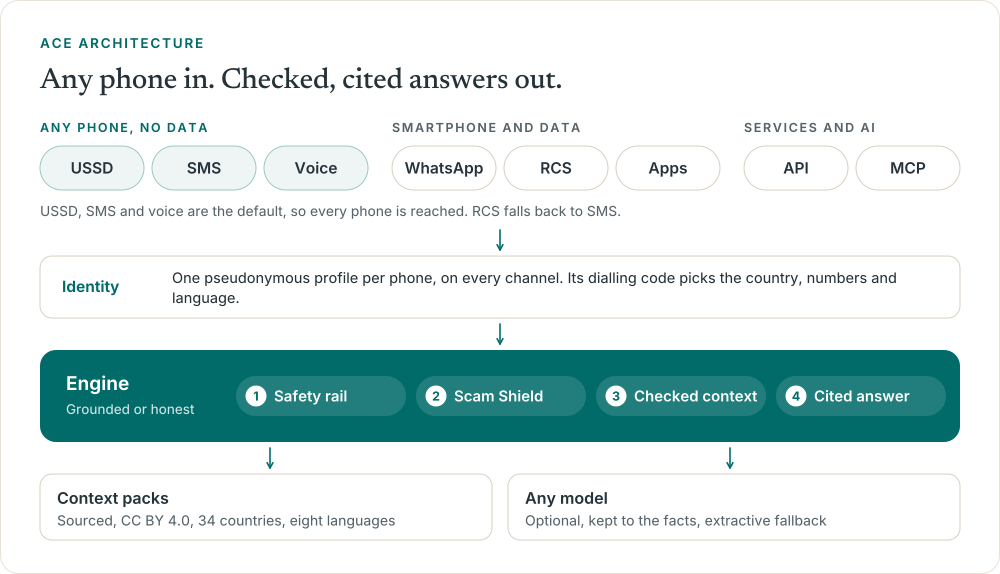

# ACE: the African Context Engine

[](https://github.com/tbrunoh/african-context-engine/actions/workflows/ci.yml)
[](LICENSE)
[](pyproject.toml)
[](DATA_LICENSE.md)
[](docs/architecture.md#mcp)

**Checked, local, citable knowledge for Africa, on any phone.**

ACE answers the questions that matter to people who will never install an app: a farmer whose maize is being eaten, a pregnant woman who is bleeding, a mother who just got an M-PESA message that feels wrong, a family deciding whether to plant before the rain. It answers on any phone (USSD, SMS/RCS, voice, WhatsApp and MCP), in eight languages across 34 African countries, and every answer points to the published source or dated dataset it came from. It runs with no language model and no API key. When you do plug in a model, ACE checks that the model stayed with the facts and falls back when it did not.

**Reach by default, richer by choice.** USSD, SMS and voice are the default, because they reach every phone with no app and no data. People with a smartphone and data can choose WhatsApp, or RCS where their carrier supports it, to see the sources under every answer, with suggested replies on RCS; RCS falls back to SMS, so a reply never depends on RCS. Other services and AI assistants connect through the API and MCP.

**Release 2.2 preview (2.2.0b2, 25 November 2026)** adds speech and translation. ACE now measures its language tools on real African speech text from Google's open WAXAL corpus, the voice line speaks only languages a voice exists for, and optional Google Cloud providers hear spoken questions, speak replies and give fluent reviewers back translations of every string. The design and the gaps are in [docs/speech.md](docs/speech.md).

**On main, in the next release:** RCS with SMS fallback, switched on country by country. See [docs/channels.md](docs/channels.md#rcs-with-sms-fallback).

**Release 2.1 preview (2.1.0b1, 24 November 2026)** took ACE from 13 to 34 countries and from three to eight languages: English, Swahili, French, Portuguese, Arabic, Amharic, Afaan Oromo and Somali. Every new country gets all six decision services at once (rain this week, official warnings, the nearest health facility, market prices, a pregnancy companion and a crop problem check), and wherever open data does not reach, ACE names the gap in the person's language. Arabic and Amharic replies are budgeted for the smaller UCS-2 alphabet, so they still fit one USSD screen. The services and the five new languages are a preview: they pass ACE's own tests and benchmark, but no fluent speaker has reviewed the new translations yet, and the expert review and forecast skill gates in the [build plan](docs/v2/build-plan.md) are still open. The design is in [docs/v2/release-2.1.md](docs/v2/release-2.1.md).

```
$ ace ask "viwavi wanakula mahindi yangu nifanye nini" --channel sms
Huenda ni viwavijeshi vamizi. ACE haioni zao lako, hivyo kagua dalili hizi: madoa kama madirisha kwenye majani,
kilele kilicholiwa, kinyesi kibichi kama unga wa mbao. Ponda mayai na viwavi wachanga kwa mkono. Inafaa sana kwa
mashamba madogo. Muulize afisa ugani athibitishe kabla ya kunyunyizia dawa.

Sources:
  [sourced] ICIPE, Fall armyworm identification, management and control; CIFOR-ICRAF, Fall Armyworm guide
      https://technologytransfer.icipe.org/wp-content/uploads/2021/04/Fall-Armyworm-Brochure-Identification-Management-and-Control-1.pdf
  [sourced] FAO, Fall armyworm management guidance for smallholders
      https://openknowledge.fao.org/server/api/core/bitstreams/f1e28a46-3822-4c03-bc31-4294e7e83ea1/content

$ ace ask "will it rain in Kano this week" --phone +2348010000001
Rain near Kano: mostly dry Wed to Tue. Chances from the ECMWF forecast of 24 Nov.

Sources:
  [preview] ECMWF IFS ensemble forecast (open data), via Open-Meteo
      https://open-meteo.com/

$ ace ask "ባለቤቴ እርጉዝ ናት ብዙ ደም እየፈሰሳት ነው" --phone +251911234567
ይህ የእርግዝና ድንገተኛ ሁኔታ ሊሆን ይችላል። አሁኑኑ ወደ ቅርብ ጤና ተቋም ይሂዱ። 911 ወይም 907 (ድንገተኛ) ይደውሉ።

Sources:
  [sourced] UK FCDO, Ethiopia travel advice, getting help
      https://www.gov.uk/foreign-travel-advice/ethiopia/getting-help
```

## Why ACE exists

- 64% of Africans live within reach of mobile broadband but do not use mobile internet (GSMA, Digital Africa Index 2026), almost a billion people by UN population estimates. USSD, SMS and voice still reach them.
- AI advisory services are proving demand: Digital Green's FarmerChat reaches nearly 3 million farmers, Jacaranda Health's PROMPTS has reached more than 3.8 million mothers in Kenya, and MTN Rwanda's voice AI, Miss Baza, has reached more than 500,000 users on a basic phone call. Each one rebuilds its own knowledge base, channel stack and safety layer, and the knowledge stays locked inside.
- African language models are arriving (InkubaLM, Sunflower), but a model does not know which hotline handles gender based violence in Kenya or what moisture level keeps maize free of aflatoxin. Models need grounding.

ACE is the shared layer underneath: open knowledge packs anyone can load, a channel toolkit for the phones people actually use, and a safety rail that runs before anything else. The full competitive map is in [docs/landscape.md](docs/landscape.md).

## What ACE does

| Capability | What it means for a person | Where |
|:--|:--|:--|
| **34 countries, one engine** | The caller's dialling code picks the country, so the numbers, topics and default language are always right for that person | `countries.py`, `engine.py` |
| **Eight languages** | English, Swahili and French in the code; Portuguese, Arabic, Amharic, Afaan Oromo and Somali in one file each, so a new language needs no code change | `i18n.py`, `locales/` |
| **Grounded answers** | Short, practical answers in the person's language, each traced to a published source | `engine.py`, `context/` |
| **Safety rail** | Emergency language in any of the eight languages gets that country's verified numbers at once and a human handoff, before retrieval or any model. ACE never gives a number from another country | `safety.py` |
| **Scam Shield** | Forward a suspicious mobile money message in any of the eight languages and get an explained verdict. In Kenya it cites Safaricom's own guidance; elsewhere it gives no number it cannot cite. It never calls a message safe | `scam.py` |
| **USSD app** | A full menu on any phone: browse topics, ask in your own words, check a message, switch language. Every screen fits 182 characters | `channels/ussd.py` |
| **SMS** | Replies within three segments, folded into GSM-7 for Latin script and budgeted for UCS-2 in Arabic and Amharic, keyword commands, Africa's Talking sending | `channels/sms.py`, `encoding.py` |
| **RCS** | Suggested replies and sources in the phone's own messaging app, switched on per country. ACE checks that each person can receive RCS and falls back to SMS, and composes every reply to the SMS budget so the fallback never cuts it | `channels/rcs.py` |
| **Voice IVR** | Keypad menu over the same knowledge, spoken only in languages with a known voice, plus speech recognition through any provider; Google Cloud is ready to plug in | `channels/voice.py`, `speech/` |
| **WhatsApp** | Cloud API webhook with signature checks, sources listed under every answer | `channels/whatsapp.py` |
| **MCP server** | Any AI assistant can ask ACE for cited African context, scam checks and emergency numbers | `mcp_server.py` |
| **Privacy by design** | Phone numbers stored only as salted hashes; FORGET, FUTA or OUBLIER deletes everything | `identity.py` |
| **Community loop** | Text TIP, DOKEZO or ASTUCE with your advice; it waits for expert review and is never served until checked | `tips.py` |
| **Playground** | A phone simulator in the browser for USSD and SMS, with the sources behind every reply | `ace serve` |

### Coverage: 34 countries

98 facts across 41 packs, with 110 emergency and helpline numbers. Every fact was checked against a published public source in November 2026, every emergency number expires after a year so it is checked again before it is served, and the number watcher rechecks each one weekly. The first 13 countries joined in 1.1; the other 21 joined in 2.1.

| Country | Calling code | Languages offered | Emergency and helpline numbers | Sources for the numbers |
|:--|:-:|:--|:--|:--|
| Kenya | +254 | English, Swahili | 999, 112, 911, 1199, 1195, 116, 1190 | State Department for Gender, NASCOP |
| Tanzania | +255 | Swahili, English | 112, 116 | UK FCDO, Government of Canada, Child Helpline International |
| Uganda | +256 | English, Swahili | 999, 112, 0800 199 195, Sauti 116 | Uganda Police via Nile Post, UNICEF Uganda, UK FCDO |
| Rwanda | +250 | English, French | 112, 912, 3512, 116 | Government of Rwanda |
| South Africa | +27 | English | 112, 10111, 10177, 0800 428 428, 116 | Department of Justice, UK FCDO |
| Botswana | +267 | English | 999, 997, 998, 11611 | Botswana Police Service, Child Helpline International |
| Namibia | +264 | English | 10111, 112, 106, 116 | UK FCDO, LifeLine/ChildLine Namibia |
| Zimbabwe | +263 | English | 999, 112, 114, 0800 3222 911, 116 | UK FCDO, Government of Canada |
| Nigeria | +234 | English | 112, 0800 800 8001, 0808 0551 376 | UK FCDO, NCC, Child Helpline International |
| Ghana | +233 | English | 112, 191, 18555, 192, 193, 0800 111 222 | Government of Canada, Ministry of Gender, Children and Social Protection |
| Senegal | +221 | French | 17, 15, 18, 1515, 116 | UK FCDO, Ministère de la Santé |
| Côte d'Ivoire | +225 | French | 170, 110, 111, 185, 180, 1308, 116 | UK FCDO, Ministère de la Femme, de la Famille et de l'Enfant |
| Togo | +228 | French | 117, 118, 1011 | UK FCDO, Government of Canada, Child Helpline International |
| DR Congo | +243 | French, Swahili | 112, 118 (Kinshasa) | UK FCDO |
| Malawi | +265 | English | 998, 990, 997, 999 | UK FCDO |
| Burundi | +257 | French, Swahili | 112, 109 | UK FCDO |
| Cameroon | +237 | French, English | 112, 117, 119 | UK FCDO |
| Benin | +229 | French | 118, 117 | UK FCDO |
| Zambia | +260 | English | 992, 991, 993 | UK FCDO |
| Chad | +235 | French, Arabic | 112, 18, 117, 2020 | UK FCDO |
| Guinea | +224 | French | None national: go to the nearest health facility | UK FCDO |
| Burkina Faso | +226 | French | 18, 17 | UK FCDO |
| South Sudan | +211 | English, Arabic | None national: go to the nearest health facility | UK FCDO |
| Ethiopia | +251 | Amharic, Afaan Oromo, Somali, English | 911, 907 | UK FCDO |
| Mozambique | +258 | Portuguese | 112, 198 | UK FCDO |
| Guinea-Bissau | +245 | Portuguese, French | 1313, 117 | UK FCDO |
| Angola | +244 | Portuguese | 112, 110, 118 | UK FCDO |
| Somalia | +252 | Somali, Arabic, English | 446, 999, 888, 555 | UK FCDO |
| Sudan | +249 | Arabic, English | 999 | UK FCDO |
| Algeria | +213 | Arabic, French | 1021, 14, 17, 1548 | UK FCDO |
| Egypt | +20 | Arabic, English | 123, 122, 180 | UK FCDO |
| Libya | +218 | Arabic, English | 1415 | UK FCDO |
| Morocco | +212 | Arabic, French | 150, 190, 177 | UK FCDO |
| Tunisia | +216 | Arabic, French | 190, 198, 197, 193 | UK FCDO |

Four packs apply in every covered country, in all eight languages:

| Pack | Facts | Sources |
|:--|:-:|:--|
| Danger signs in pregnancy and after birth | 5 | WHO. ACE adds the caller's own national numbers |
| Antenatal care schedule | 2 | WHO 2016 recommendations |
| Fall armyworm in maize | 8 | FAO guidance notes, ICIPE, CIFOR-ICRAF. Offered in the 29 sub-Saharan countries and Egypt, where the pest is confirmed. Push-pull is offered only where ICIPE has disseminated it |
| Crop pests and diseases | 8 | CIMMYT, CABI Plantwise, Bioversity International, IITA, World Vegetable Center |

Three packs so far are for one country, Kenya: maize drying and aflatoxin (7 facts, KALRO, USAID AflaSTOP, CGIAR), mobile money safety (10 facts, Safaricom) and rainfall seasons (2 facts, Kenya Meteorological Department). Equivalent packs for the other 33 countries are the most valuable contribution a local expert can make.

Where a public source does not publish a number, ACE does not invent one. Guinea and South Sudan have no national emergency number, and Togo and DR Congo no national ambulance number, so a medical emergency there gets the instruction to go to the nearest health facility. DR Congo's police and fire numbers serve Kinshasa, and the FCDO warns that Malawi's lines are unreliable and Sudan's services are disrupted; the packs say so. Botswana's police publish two different GBV toll free numbers, so ACE routes GBV to the police on 999 until the conflict is resolved. The Swahili and French renderings, and everything in the five new languages, await review by fluent speakers.

## Decision services on public data, in all 34 countries


Each service answers one decision in one or two sentences, cites a dated snapshot or a sourced pack fact, and returns a refusal that names who to ask when it cannot answer safely. The safety rail still runs before every service, and services never touch the network: connectors fetch public data on a schedule and write dated, checksummed snapshots that services read.

| Service | What a person hears | Built on | Coverage of the 34 countries |
|:--|:--|:--|:--|
| **Rain this week** | The chance of rain each day for their area, in plain words, with the forecast date | ECMWF IFS ensemble (51 runs), open data, via Open-Meteo | All 34 |
| **Official warnings** | Any warning in force from the national alerting authority, in the authority's own words | CAP feeds listed in the WMO Register of Alerting Authorities | 30 publish a feed; 29 answered at the last refresh, because South Africa's was down. Rwanda, Namibia, Angola and Morocco list none. `ace services` shows which feeds answered |
| **Nearest health facility** | The nearest public facilities with type and distance, then the country's emergency number | Public health facility database for sub-Saharan Africa (Maina et al. 2019, KEMRI-Wellcome) | 29 sub-Saharan countries (84,060 public facilities, 2019 list, no phone numbers). Algeria, Egypt, Libya, Morocco and Tunisia have no open list yet |
| **Market prices** | What a food cost in the nearest market, and the change on the month before | WFP Price Database, via HDX | 23 with current prices. Botswana, Morocco and Tunisia have no WFP data; South Africa, Namibia, Zimbabwe, Ghana, Mozambique, Angola and Somalia have none recent enough to quote; Zambia's cover too few staple foods |
| **Pregnancy companion** | When the next antenatal check is due, the signs that mean go now, and the country's numbers | WHO 2016 antenatal care schedule; WHO danger signs | All 34 |
| **Crop problem check** | The likely problem for maize, cassava, banana or tomato, the first step, and a referral before any spraying | FAO, CIMMYT, CABI Plantwise, Bioversity International, IITA, World Vegetable Center | All 34 |

Places come from official and open boundaries for every country: 719 areas, so a person can name their county, state, region or district instead of sharing a GPS position. Run `ace services` for the live coverage table, with the reason for every gap.

```
$ ace ask "nearest hospital in Gulu" --phone +256771000001
Public hospitals in Gulu: Gulu Regional Referral Hospital (regional referral hospital); St. Mary's Lacor
Hospital (hospital). Emergency: 999, 112. From a 2019 list of public facilities; check it is open before you travel.
```

**What 2.2 adds**

- **A language check on real speech**: `python -m benchmark.waxal` runs ACE's language guess, safety rail and service router on 12,333 sentences from 27 WAXAL sets. ACE recognises Amharic, Swahili and Afaan Oromo in 93% to 100% of sentences, and the safety rail fired on 3 ordinary sentences in 12,333. Across 23 languages it does not speak, ACE still mistakes an average of 45.8% of sentences for one of its own languages, most often Swahili, down from 54.0%. No WAXAL text is stored in the repository.
- **A voice line that only speaks what it can say**: the Africa's Talking Say action reads English, Swahili, French, Portuguese and Arabic with Google Cloud voices. With a Gemini API key, ACE synthesises Amharic and Somali with Gemini 3.8 Flash TTS and the call plays the audio. No Google model speaks Afaan Oromo yet, so Oromo callers hear the next language of their country with a voice and get the full reply on SMS and USSD in their own language.
- **Speech and translation providers**: `SpeechToText`, `TextToSpeech` and `Translator` interfaces, with Google Cloud Speech-to-Text (Chirp 3), Text-to-Speech and Cloud Translation behind the optional `google` extra, and Gemini 3.8 Flash TTS for the languages Cloud Text-to-Speech cannot speak. `ace voice languages` shows what exists for each language, with sources.
- **Help for reviewers**: `ace locales backcheck am` lines up every Amharic string with a machine back translation, the strings most likely to have drifted first. Reports for the five newest languages are in [docs/reviews](docs/reviews/README.md). Translation never runs while answering a person.

**What 2.1 added**

- **21 countries**: DR Congo, Malawi, Burundi, Cameroon, Benin, Zambia, Chad, Guinea, Burkina Faso, South Sudan, Ethiopia, Mozambique, Guinea-Bissau, Angola, Somalia, Sudan, Algeria, Egypt, Libya, Morocco and Tunisia, each with an emergency pack and all six services.
- **Five languages**: Portuguese, Arabic, Amharic, Afaan Oromo and Somali, in one locale file each, with Arabic normalisation, Ge'ez letter folding, script based language detection and the call verb where each language puts it. The guide is [docs/languages.md](docs/languages.md).
- **The right alphabet for every reply**: Latin script folded into GSM-7 on SMS and USSD, and Arabic and Amharic composed for UCS-2 budgets (80 characters a USSD screen).
- **Five data problems designed around**: warnings drawn around a whole country, broken warning polygons, 2,611 facilities in the wrong place, price lists too thin to quote, and national registries with no stated licence, held until cleared.
- **A benchmark in eight languages**: recall 100% in every language from numbers in all 34 countries, and 1,464 of 1,464 service checks.

**What else ships in 2.0**

- **Connectors and snapshots.** Six connectors (`ace refresh`), one held until its licence is cleared, a licence register (`snapshots/register.yaml`) and dated, checksummed snapshots. ODbL data lives in its own store. A deployment runs `ace refresh` on its own schedule: warnings hourly, weather twice a day, prices weekly. The repository refreshes its demo set daily.
- **The number watcher.** `ace watch` rechecks every served phone number against its source page every week and opens an issue for a person when one is not found. It never edits a pack on its own.
- **A public benchmark.** `python -m benchmark.run` reports emergency recall per language, the wrong number rate, the false alarm rate and service checks for every covered country. CI fails on any regression. The red team set is small and written by maintainers, so field messages are the most useful contribution.
- **Grounding for every assistant.** `POST /v1/services/<id>` on the web server, and seven new MCP tools: `rain_this_week`, `official_warnings`, `nearest_facility`, `market_prices`, `pregnancy_companion`, `pest_check` and `service_coverage`.
- **USSD menu.** The six services come first on the menu, with topics, questions, Scam Shield and language behind them. Every screen still fits 182 characters.
- **New packs.** Antenatal care (WHO) and four crop pests and diseases (maize lethal necrosis, cassava mosaic disease, banana Xanthomonas wilt, tomato leaf miner), in English, Swahili and French.

**Not in this preview.** Spoken replies in Afaan Oromo, speech recognition tuned on WAXAL, the planting window, soil advice, flood forecasts, Scam Shield 2 with SIM swap checks, opt in alerts and health worker assist are still on the [roadmap](ROADMAP.md). Each needs data access, partners or expert review that a code release cannot supply. Read the [product spec](docs/v2/product-spec.md), the [services guide](docs/services.md), the [data and model catalog](docs/v2/data-catalog.md) and the [build plan](docs/v2/build-plan.md). AI coding agents follow [AGENTS.md](AGENTS.md).

## Quickstart

```bash
git clone https://github.com/tbrunoh/african-context-engine.git
cd african-context-engine
python -m venv .venv && source .venv/bin/activate
pip install -e ".[dev]"

pytest                                   # 500+ tests, about two minutes
ace demo                                 # one person, four channels, one memory
ace services                             # the V2 services and their coverage in each country
ace ask "bei ya mahindi Mwanza" --phone +255711000001
ace ask "vai chover em Nampula esta semana" --phone +258841000001
ace chat --channel ussd                  # a USSD session in your terminal
ace scam "Your SIM is registered twice. Send your M-PESA PIN to confirm"
ace serve                                # open http://127.0.0.1:8000 for the phone playground
```

The preview wheel is attached to the [v2.2.0b2 release](https://github.com/tbrunoh/african-context-engine/releases). Publishing to PyPI waits on a one time trusted publisher setup by the maintainer. Connect a real shortcode in [docs/channels.md](docs/channels.md). Add a language model in [docs/architecture.md](docs/architecture.md#language-models).

## How it works



```
 USSD  SMS  Voice    WhatsApp  RCS  Apps   API  MCP     thin adapters, one Message type
 any phone, no data  smartphone, data      services     RCS falls back to SMS
      \    |   /         \     |   /        \   /
    +---------------- Engine ----------------+
    | identity    one pseudonymous profile across channels
    | safety      emergency phrases -> verified numbers + human handoff
    | commands    HELP  LANG SW  TIP  SCAM  SOURCES  MORE  FORGET
    | scam        Scam Shield on forwarded money messages
    | services    V2: rain, warnings, facilities, prices, pregnancy, crops
    | i18n        eight languages, GSM-7 or UCS-2 budgets per language
    | retrieve    filters (review, expiry, place, season) then BM25 ranking
    | compose     extractive by default, or a model with a grounding check
    +----------------------------------------+
                      |
   Context packs (YAML, CC BY 4.0)    Snapshots (dated, checksummed, licence registered)
                                              ^
                                     Connectors (ace refresh, on a schedule)
```

Design choices that matter:

- **Nothing reaches a person unless it is grounded in a checked fact, a dated snapshot or is a fixed system message.** Draft and expired facts, and snapshots past their validity, are withheld by default.
- **Safety first, always.** The rail runs before commands, retrieval and generation. HELP followed by an emergency is still an emergency.
- **Honest about gaps.** When no checked fact matches, ACE says so and lists what it can help with. When a country has no data for a service, ACE names the gap instead of guessing, and it never says there is no warning unless it checked the official feed in the last six hours.
- **Fits the channel.** Each channel has a character budget, and answers are composed to fit rather than cut mid sentence.
- **No vendor lock-in.** Standard library plus PyYAML. Any OpenAI compatible model server works, including models you host yourself.

## Contributing

ACE grows through two kinds of contributors, and both matter equally.

- **People who know a place**: extension officers, clinicians, midwives, agronomists, translators and meteorologists in any of the 34 countries or beyond. Add facts to a pack, review a translation in Swahili, French, Portuguese, Arabic, Amharic, Afaan Oromo or Somali, add red team messages people actually send, or start a pack for your country. No coding needed. Start with [docs/context-packs.md](docs/context-packs.md).
- **Developers**: new connectors that close a gap in the coverage table, new channels, languages, retrieval and evaluation. See [docs/good-first-issues.md](docs/good-first-issues.md) for scoped starter tasks.

Everything else is in [CONTRIBUTING.md](CONTRIBUTING.md). The plan is in [ROADMAP.md](ROADMAP.md).

## Safety and responsibility

ACE is not a doctor, agronomist, lawyer or bank. It shares published guidance and tells people when and where to get human help. The safety phrases and every translation, in all seven languages after English, need review by clinicians and fluent speakers before a public launch, and each deployment is responsible for its own data protection obligations. Read [docs/safety-and-privacy.md](docs/safety-and-privacy.md) before you deploy. Report vulnerabilities through [SECURITY.md](SECURITY.md).

## Acknowledgments

ACE uses guidance and data published by the World Health Organization, FAO, ECMWF, WFP, OCHA, the national meteorological services that publish CAP warnings, the KEMRI-Wellcome Trust Research Programme, CIMMYT, CABI, IITA, Bioversity International, the World Vegetable Center, ICIPE, KALRO, Safaricom, the UK Foreign, Commonwealth and Development Office, national governments and regulators in all 34 countries, Child Helpline International, geoBoundaries, Open-Meteo, UN agencies and others. Every fact names its source, and [ACKNOWLEDGMENTS.md](ACKNOWLEDGMENTS.md) credits each organisation, and `snapshots/register.yaml` records the licence of every dataset. A credit does not mean the organisation endorses ACE.

## License

Code: [Apache License 2.0](LICENSE). Open context packs: CC BY 4.0, see [DATA_LICENSE.md](DATA_LICENSE.md).

---

<sub>Created by <a href="https://tbrunoh.github.io/">Tom Bruno</a>, Product and Ecosystem Leader in AI Ecosystems at Google, as a personal project, and maintained with the <a href="AUTHORS">ACE contributors</a>. Project page: <a href="https://tbrunoh.github.io/ace/">tbrunoh.github.io/ace</a>.</sub>
