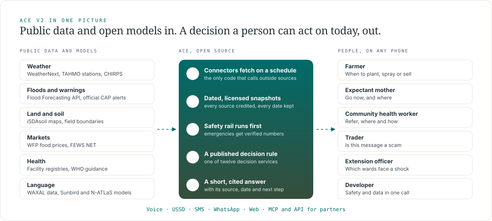
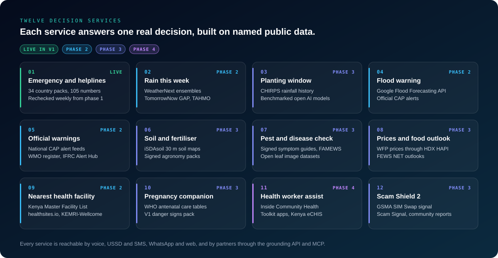
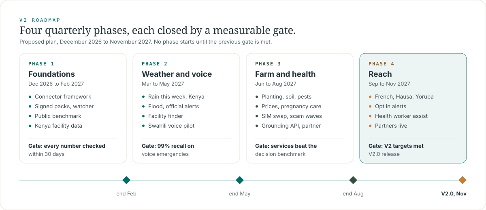

# ACE V2

V2 turns the best public data and open models into decisions people can act on today, on any phone. It keeps everything release 1.1.0 proved and adds twelve decision services built on named public data, voice in African languages, knowledge that stays true, and a shared layer that any health, farming or assistant service can call.

Release 2.0 preview (2.0.0b2, 24 November 2026) ships the foundations and six of the twelve services: rain this week, official warnings, nearest health facility, market prices, the pregnancy companion and the crop problem check. Each covers all 13 countries wherever open data exists and names the gap where it does not. The [services guide](../services.md) has the decision rules and the coverage, and the [connector pages](../connectors/README.md) have the sources. The rest of V2 follows the roadmap below.

## Start here

Read the three documents in this order. Each one stands on its own.

| Document | What it covers |
| --- | --- |
| [Product spec](product-spec.md) | The big picture, who V2 serves, the twelve services, three journeys, pillars, architecture, roadmap, measures, risks and the decisions needed before phase 1 |
| [Data and model catalog](data-catalog.md) | Every public dataset, model and programme V2 builds on, with coverage, access and licence |
| [Build plan](build-plan.md) | How the work runs in Google Antigravity: repository layout, the two contracts, epics with done criteria, first sprint prompts and the evaluation plan |

The agent rules for the build are in [AGENTS.md](../../AGENTS.md). Every organisation whose work ACE uses, today or in V2, is credited in [ACKNOWLEDGMENTS.md](../../ACKNOWLEDGMENTS.md).

