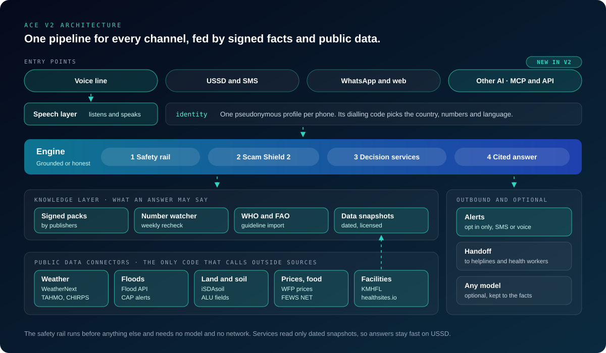

# Build plan for Google Antigravity

This plan turns the [product spec](product-spec.md) into work an agent team can start on day one. It assumes Antigravity 2.0, Google's agent development platform announced at I/O in May 2026, with its desktop app, the agy CLI and the SDK. The V1 repository stays the base: every V2 module plugs into the existing engine, and V1's 272 tests must keep passing. The rules every agent follows are in [AGENTS.md](../../AGENTS.md).



Status on 24 November 2026: release 2.0 preview delivered E0 (foundations, the benchmark in CI and the number watcher) and first versions of E1, E2, E3, E4, E5 and E8 for 13 countries, and release 2.1 preview took them to 34 countries and eight languages, all labelled preview. The done criteria below are the gates each service must still pass to leave preview.

## How ACE uses each Antigravity feature

| Antigravity feature | How ACE uses it |
| --- | --- |
| AGENTS.md and project rules | The rules in AGENTS.md, loaded into every agent, so no agent can weaken the safety rail or ship an uncited answer |
| Skills | One skill per repeated job: add a connector, add a service, add a language, add a pack |
| Workflows | Saved runs for a new connector, a new service and a release, each ending in tests and the benchmark |
| Parallel subagents in worktrees | One agent per epic on its own branch: connectors, services, voice, benchmark, docs |
| Hooks | Block a change to the safety rail without a passing red team run; block anything that looks like a secret |
| MCP | Mount ACE's own MCP server so agents can query it while they build, plus GitHub |
| Plans, walkthroughs, screenshots and browser recordings | Review evidence on every pull request, especially USSD and web flows |
| Headless CLI and scheduled tasks | Nightly connector refresh and full benchmark run, with results written to the repo |
| SDK safety policies | Declared limits for agents: no network outside registered connectors, no writes outside the repo |

## Repository layout: what V2 adds to V1

```text
african-context-engine/
  AGENTS.md                     # agent rules
  ACKNOWLEDGMENTS.md            # credit for every source ACE uses
  agent/skills/                 # add-connector, add-service, add-language, add-pack
  agent/workflows/              # new-connector, new-service, release
  src/ace_engine/
    engine.py safety.py scam.py # V1, unchanged contracts
    connectors/                 # NEW: the only code that touches the network
      base.py weathernext.py gap.py flood.py cap.py
      isda.py alu.py hdx_prices.py fewsnet.py
      kmhfl.py healthsites.py simswap.py
    snapshots/                  # NEW: signed, dated cache that services read
      store.py licence.py
    services/                   # NEW: one module per decision service
      base.py emergency.py rain.py planting.py flood.py warnings.py
      soil.py pests.py prices.py facility.py pregnancy.py chw.py scam.py
    speech/                     # NEW: asr.py kws.py tts.py
    channels/ server.py mcp_server.py
  context_packs/                # V1 packs, now signed
  benchmark/                    # NEW: sets/ run.py report.py
  docs/connectors/<name>.md     # access, licence, refresh, fallback
  tests/
```

## Two contracts every agent builds against

```python
class Connector(Protocol):
    name: str              # flood_forecasting
    licence: str           # CC-BY-4.0
    refresh: timedelta     # how often fetch() runs
    fallback: str | None   # connector used when this one is down
    def fetch(self, region: Region) -> Snapshot: ...
    def health(self) -> ConnectorHealth: ...

@dataclass(frozen=True)
class Snapshot:
    source: str
    licence: str
    retrieved_at: datetime
    valid_until: datetime
    region: Region
    data: Mapping[str, Any]
    checksum: str

class Service(Protocol):
    id: str                          # rain_this_week
    countries: frozenset[str]        # {KE, TZ, UG}
    connectors: tuple[str, ...]
    def answer(self, q: Query, snaps: SnapshotReader) -> Answer | Refusal: ...

@dataclass(frozen=True)
class Answer:
    text: dict[str, str]             # per language, inside the channel budget
    citations: tuple[Citation, ...]  # source, date, licence for each fact
    confidence: Literal['high', 'medium', 'low']
    next_step: str | None            # the one thing to do now
```

- Services never call the network. Connectors fetch on a schedule and write snapshots; services read them. USSD stays fast, and an answer still works when a source is down.
- Every answer carries the snapshot date, so a person always knows how fresh the forecast or price is.
- A service that cannot answer safely returns a Refusal that names a person to contact: the helpline, the extension officer or the health worker.
- The V1 pipeline order does not change: country, safety rail, Scam Shield, then services.

## Epics, first tickets and when each is done

| Epic | First tickets | Done when | Phase |
| --- | --- | --- | --- |
| E0 Foundations | Connector base and snapshot store; licence register; contract test kit; benchmark runner in CI | A sample connector passes the contract tests; every snapshot carries source, licence, date and checksum; CI fails on any benchmark regression | 1 |
| E1 Weather | WeatherNext connector on BigQuery; GAP connector; rain this week service out of preview in every covered country | On 2022 to 2025 hindcasts the service beats the season average at weather stations in each country, TAHMO where available; every answer fits one SMS | 2 |
| E2 Floods and warnings | Flood Forecasting API connector; CAP connector driven by the WMO register; flood and warning services; opt in alerts | A replayed CAP alert reaches test phones within 15 minutes; nobody who did not opt in receives it | 2 |
| E3 Facilities | KMHFL connector; healthsites.io connector in its own ODbL store; facility finder by service type | Nearest facility correct on a hand checked sample of 200 locations spread across the covered countries; when no number is listed, ACE gives the national line | 2 |
| E4 Farm | iSDAsoil and Agricultural Understanding connectors; pest symptom trees from signed packs; HDX HAPI price connector; planting window service | An agronomist panel reviews 50 answers per crop and finds no unsafe advice; every price shows its market and date | 3 |
| E5 Health | WHO antenatal care kit importer; pregnancy companion; Community Health Toolkit integration through the grounding API | Every danger sign in the kit has a safety rail test; a clinician panel signs off; a CHT test instance calls ACE end to end | 3 and 4 |
| E6 Voice | Swahili speech recognition tuned on WAXAL; keyword spotting for danger words; text to speech; voice channel | 99% emergency recall on the voice red team set; keypad fallback on every turn | 2 to 4 |
| E7 Scam Shield 2 | SIM Swap connector through an operator or aggregator sandbox; scam service; scam wave grouping | Recall and false alarm rate published per country | 3 |
| E8 Grounding | MCP tool and API route per service; partner keys and rate limits; citation badge rule | A partner sandbox passes the safety benchmark | 3 |

## First sprint: five prompts to hand the agents

1. **Planner.** Read AGENTS.md, docs/architecture.md and docs/v2/product-spec.md. Break epic E0 into pull requests under 400 lines each, list the tests each adds, and stop for review before writing code.
2. **Connector agent, in its own worktree.** Build connectors/base.py and snapshots/store.py to the contracts in this plan, with a fake connector and contract tests. Do not touch safety.py.
3. **Benchmark agent.** Add benchmark/run.py with a quick mode for CI and a full mode for nightly runs. Start from the V1 safety tests and report emergency recall per language.
4. **Weather agent, after E0 merges.** Build the GAP connector against its documented REST API with a key from the environment, then extend the rain this week service with it in every covered country. Add the connector to ACKNOWLEDGMENTS.md and docs/connectors/. Show a walkthrough of five sample answers from different countries in several of the eight languages.
5. **Reviewer.** On every pull request, run the checks in AGENTS.md, confirm that each new user facing string exists in every supported language (`i18n.missing()` is empty), confirm that every new source is credited, and reject any answer without a citation.

## Evaluation plan: every gate is a published number

| What we measure | How | Proposed gate |
| --- | --- | --- |
| Emergency recall, text and voice | Red team sets per language | 99% in every language |
| Forecast usefulness | Rain or no rain hit rate against TAHMO stations, compared with the season average from CHIRPS | Beats the season average before launch |
| Planting window | Predicted onset against observed onset in CHIRPS history | Launch only in zones where skill is shown |
| Facility accuracy | Monthly phone check of a random sample | 95% correct |
| Advice safety | Domain panels: agronomists for farm answers, clinicians for health answers | No unsafe answer in the review set |
| Freshness | Share of answers whose snapshot is inside its validity window | 99% |
| Speed | Time from request to reply on USSD | Inside the operator's session limit |

## Definition of done for any new service

- It answers one named decision for one named person, in one or two sentences, with a next step.
- Every fact in the answer cites a signed pack or a dated snapshot, the licence register covers each source, and ACKNOWLEDGMENTS.md credits it.
- It has an open fallback, a Refusal path and tests in every supported language.
- It passes the benchmark gate for its domain, and a domain expert has reviewed a sample of answers.
- It is exposed through USSD and SMS, the voice line, the grounding API and MCP.
