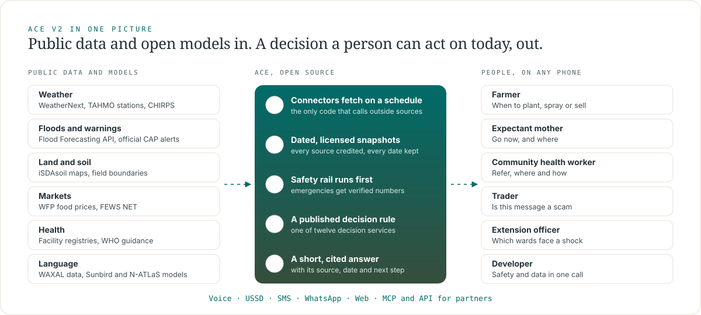
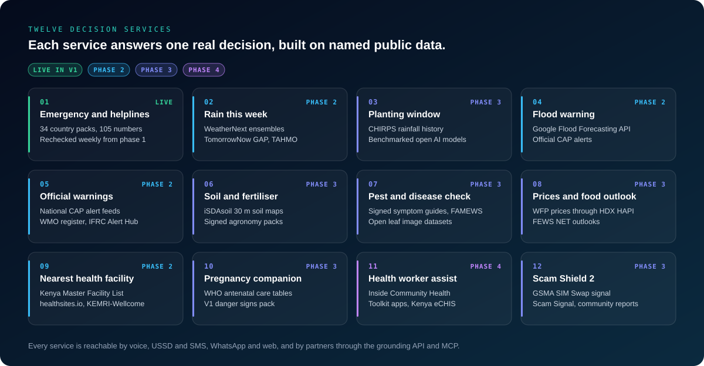
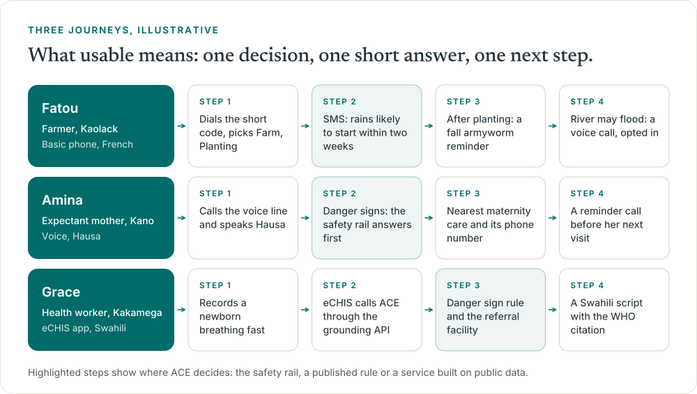
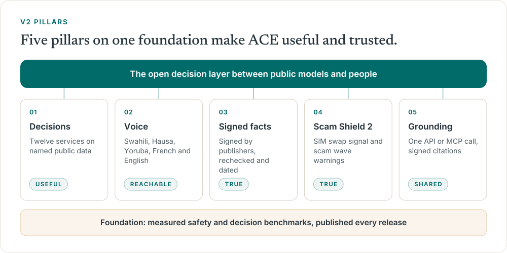
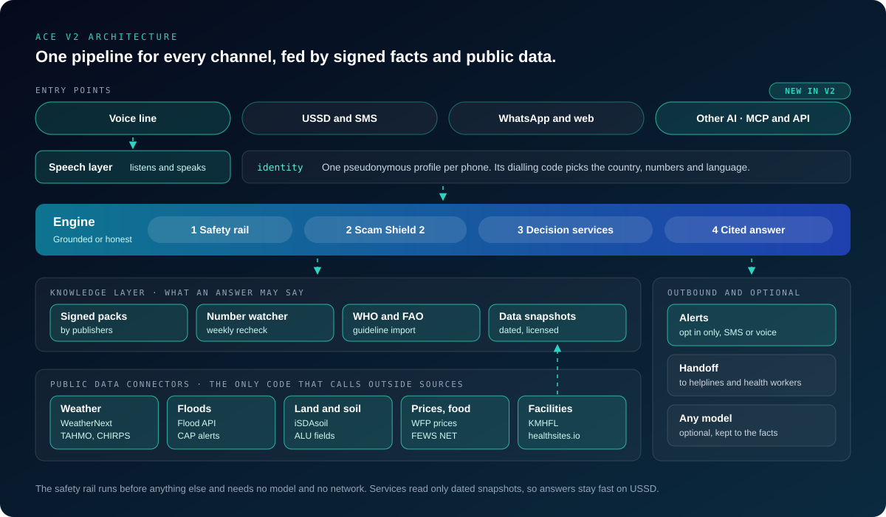
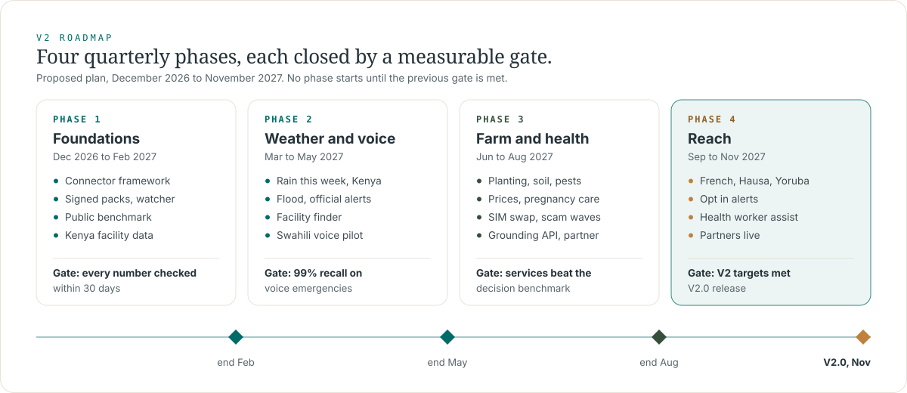

# ACE V2 product design

24 November 2026 · Tom Bruno

**Status.** Release 2.1 preview (24 November 2026) ships six of the twelve services in 34 countries and eight languages, after release 2.0 preview shipped them for the first 13 countries the same day: rain this week, official warnings, nearest health facility, market prices, the pregnancy companion and the pest check. Each is labelled a preview until it passes its gate. Release 2.2 preview (25 November 2026) adds the first pieces of the voice line; see [speech.md](../speech.md). The [services guide](../services.md) has the decision rules, coverage and gaps.

**On this page:** [Summary](#summary-v2-turns-the-best-public-data-and-open-models-into-decisions-people-can-act-on-today-on-any-phone) · [The big picture](#the-big-picture-the-data-now-exists-the-last-mile-does-not) · [Who V2 serves](#who-v2-serves-six-people-each-facing-a-decision-that-cannot-wait) · [Twelve services](#what-v2-ships-twelve-decision-services-each-built-on-named-public-data) · [Journeys](#three-journeys-show-what-usable-means) · [Pillars](#five-pillars-carry-v2-on-one-foundation-of-measured-safety) · [Architecture](#architecture-v1s-pipeline-stays-v2-adds-speech-in-front-decision-services-in-the-middle-and-public-data-connectors-behind) · [Roadmap](#roadmap-foundations-first-then-weather-and-voice-then-farm-and-health-then-reach) · [Measures](#how-we-will-know-it-works-nine-measures-published-every-release) · [Risks](#risks-and-safeguards-the-biggest-risk-is-a-confident-voice-giving-a-wrong-instruction) · [Decisions](#decisions-needed-before-phase-1) · [Sources](#sources)

## Summary: V2 turns the best public data and open models into decisions people can act on today, on any phone

In the last two years Google, the Gates Foundation, WHO, FAO and African research groups have published what the last mile always lacked: AI weather and flood forecasts, soil maps, field boundaries, health facility registries, clinical guidance in machine readable form and open speech data in African languages. Very little of it reaches the farmer, the expectant mother or the community health worker who needs it, because it arrives as rasters, APIs and PDFs, mostly in English, built for smartphones.

V2 makes ACE the open layer that closes that gap. It keeps everything V1 proved (safety first, checked facts, the country taken from the dialling code) and adds four things:

- **Twelve decision services built on public data.** From a planting window to the nearest clinic with maternity care, each service answers one real decision in one or two sentences, with its source, its date and a next step.
- **Voice in African languages.** Open speech data and models such as WAXAL, Sunbird, N-ATLaS and Intron make a voice line usable without reading or typing.
- **Knowledge that stays true.** Packs signed by the institutions that publish them, automatic rechecks of every number, and WHO and FAO guidance imported in machine readable form.
- **A shared layer for everyone else.** Every service is one API or MCP call away, so health, farming and assistant services ground themselves in ACE instead of rebuilding it.

The aim is a product people use every week, not only in an emergency, and a layer that funded programmes such as the Gates Foundation and Google farmer initiative and Horizon1000 can build on instead of duplicating. Every source sits in the [data and model catalog](data-catalog.md), and the work plan for agents sits in the [build plan](build-plan.md).

## The big picture: the data now exists, the last mile does not

**Supply has arrived.** Six releases show how far public models have moved toward Africa:

- Google's MetNet gives short term rain forecasts across Africa in Search, within 5 km, every 15 minutes, for the next 12 hours ([Google](https://blog.google/feed/google-ai-weather-forecasting-africa/)).
- WeatherNext 2 publishes a 64 member, 15 day global forecast every six hours in BigQuery, Earth Engine and Cloud Storage ([Google](https://developers.google.com/weathernext/guides/models-wn2)).
- Google's flood models forecast riverine floods up to seven days ahead, with Flood Hub covering more than 150 countries and an API under CC BY 4.0 ([Google Research](https://sites.research.google/gr/floodforecasting/api-waitlist)).
- Agricultural Landscape Understanding maps individual field boundaries in Kenya, Uganda, Ghana, Rwanda, Zambia and Nigeria ([Google DeepMind](https://deepmind.google/science/agricultural-understanding/)).
- WAXAL opened speech data for 27 Sub-Saharan languages under CC BY 4.0 and CC BY-SA 4.0 ([Google Research](https://research.google/blog/waxal-a-large-scale-open-resource-for-african-language-speech-technology/)).
- MedGemma, Google's open medical models, has passed 10 million downloads ([Google](https://blog.google/innovation-and-ai/technology/health/medgemma-global-healthcare/)).

**Funding has moved to delivery.** In September 2026 the Gates Foundation committed $1 billion to equitable AI, with 10% for agriculture ([DevelopmentAid](https://www.developmentaid.org/news-stream/post/210586/gates-foundation-pledges-us1-billion-to-expand-equitable-access-to-ai)). With Google it is directing $100 million to bring AI climate and crop insights to 200 million smallholders in Sub-Saharan Africa and South Asia, up from 50 million ([Google](https://blog.google/company-news/outreach-and-initiatives/google-org/partnering-with-the-gates-foundation-to-bring-ai-resources-to-200-million-farmers-across-the-global-south/)). Horizon1000, with OpenAI, puts $50 million behind AI in 1,000 primary care clinics by 2028, starting in Rwanda, where there is one health worker per 1,000 people ([Fortune](https://fortune.com/2026/01/21/gates-foundation-openai-50-million-partnership-africa-rwanda-horizon1000/)). TomorrowNow and KALRO already send weather alerts to more than 5 million Kenyan farmers ([Gates Foundation](https://www.gatesfoundation.org/?p=14956)).

**The last mile is the gap.** Each programme rebuilds the same plumbing: a channel that works on a basic phone, the local language, the right number to call, a check that the advice is safe and current, and a way to turn a probability into a plain instruction. India shows what happens when that plumbing exists. In 2025, 38 million farmers received AI forecasts of monsoon onset, built on open models chosen by a decision oriented benchmark, and the forecasts caught an unusual pause of several weeks ([University of Chicago](https://climate.uchicago.edu/news/artificial-intelligence-is-helping-indian-farmers-adapt-to-climate-change-forecast-accurately-predicting-an-unusual-monsoon-season-reached-38-million/)). Economist Michael Kremer estimates that such forecasts likely return more than $100 to farmers for every dollar invested.

**ACE's opening is to be that plumbing for Africa: open source, shared and safe.** The models and datasets stay with the institutions that make them. ACE turns them into decisions a person can act on today, and makes those decisions available to every programme that needs them.

## What V1 proved, and where it stops

V1 (release 1.1.0, 23 November 2026) shows the core design works: safety before anything else, answers only from checked facts, and the caller's dialling code choosing the country.

| What V1 proved | Where V1 stops |
| --- | --- |
| 13 countries, 67 sourced facts, 54 verified emergency and helpline numbers | Most knowledge is still Kenya first; outside Kenya it is mainly emergency numbers |
| English, Swahili and French in text | People who cannot read or type are left out; there is no voice in any African language beyond keyword menus |
| Facts carry a source, a check date and an expiry | Checking is manual; nothing notices when a hotline number changes |
| Scam Shield explains warning signs in a message | It sees only the text; it cannot tell that the caller's SIM was just swapped |
| USSD, SMS, voice menus, WhatsApp, web and MCP | Every interaction starts with the person; ACE cannot warn anyone first |
| 272 automated tests, runs without an AI model | No public measure of how often it is right per country and language |

## What changed in 2026: voice is ready, fraud is worse, and the platforms closed the open door

Seven shifts since V1 was designed decide what V2 should be.

| Shift | Evidence | What it means for ACE |
| --- | --- | --- |
| WhatsApp closed to general purpose AI assistants | Since 15 January 2026, Meta's business terms bar AI providers whose assistant is the main service ([TechCrunch](https://techcrunch.com/2025/10/18/whatssapp-changes-its-terms-to-bar-general-purpose-chatbots-from-its-platform/)) | ACE must stay a scoped safety and information service on WhatsApp, and lean harder on USSD, SMS and voice, which no platform can switch off |
| African speech is now open | Google's WAXAL release covers 27 Sub-Saharan languages, with about 1,846 hours of transcribed speech under CC BY 4.0 and CC BY-SA 4.0 ([Google Research](https://research.google/blog/waxal-a-large-scale-open-resource-for-african-language-speech-technology/)); Intron's Sahara covers 57 languages, with a Swahili and English code switching model ([TechCabal](https://techcabal.com/2026/03/05/intron-expands-sahara-to-57-languages/)); Sunbird's Sunflower models cover about 40 Ugandan languages ([arXiv](https://arxiv.org/html/2510.07203v1)) | A voice line in Swahili, Hausa, Yoruba, French and English is buildable now on open data |
| Most people are still on basic handsets | 60% of mobile internet subscribers in Africa use 3G smartphones or feature phones, against 16% globally ([Semafor, citing GSMA](https://www.semafor.com/article/09/08/2025/basic-mobile-phone-costs-hold-back-africas-connectivity-report-says)) | Voice and USSD stay the primary channels; apps are secondary |
| Mobile money fraud is surging and now uses AI | INTERPOL calls mobile money fraud the most common online scam in Africa; SIM swap fraud in Kenya rose 327% in 2025, with over 123,000 fraudulent SIMs ([Business Daily](https://www.businessdailyafrica.com/bd/corporate/technology/how-kenyans-lost-sh491m-cryptos-via-sim-hijack-5547058)); criminals use AI messages and voice cloning ([Modern Ghana](https://www.modernghana.com/news/1515948/ghanaians-lost-estimated-13million-to-mobile.html)) | Text checks alone are not enough; Scam Shield needs network signals and must cover voice scams |
| Operators now expose fraud signals | GSMA Open Gateway lists SIM Swap and Scam Signal APIs ([GSMA](https://www.gsma.com/solutions-and-impact/gsma-open-gateway/gsma-open-gateway-api-descriptions/)); Kenya's NetAPI Telecom aggregates certified SIM Swap APIs for African operators ([GSMA](https://www.gsma.com/solutions-and-impact/gsma-open-gateway/netapi-telecom-gsma-open-gateway-channel-partner-africa/)) | ACE can check whether a number was just swapped before calling a message safe or unsafe |
| Agent standards went neutral | MCP moved to the Linux Foundation's Agentic AI Foundation in December 2025, with over 10,000 published servers ([Linux Foundation](https://www.linuxfoundation.org/press/linux-foundation-announces-the-formation-of-the-agentic-ai-foundation)) | ACE's MCP server becomes the way other assistants ground themselves in verified African context |
| Guidance is becoming machine readable, and regulators are watching AI | WHO SMART Guidelines publish digital adaptation kits with decision support tables ([WHO](https://www.who.int/publications/i/item/9789240020306)); Kenya's data regulator issued an AI Guidance Note in July 2026 ([ODPC](https://www.odpc.go.ke/wp-content/uploads/2026/07/AI-Guidance-Note.July-2026.pdf)) | Packs can import official guidance directly, and V2 must document how it handles voice and personal data |

The services closest to ACE are growing fast, and none of them is a shared layer. Jacaranda Health's PROMPTS answers about 15,000 maternal health questions a day by SMS ([NPR](https://www.npr.org/2026/09/17/nx-s1-5962840/artificial-intelligence-ai-chatbot-pregnancy-maternal-health)). Digital Green's FarmerChat reaches nearly 3 million farmers ([Digital Green](https://www.digitalgreen.org/insights/v2-launch-performance)). Viamo and MTN Rwanda launched Miss Baza, a voice assistant reached by dialling 845 ([Dealroom](https://dealroom.co/news/169088-mtn-rwanda-launches-miss-baza-a-voice-first-ai-anyone-can-call/)). Each builds its own facts, numbers and safety logic. ACE's opening is to supply those once, verified, for all of them.

## The V2 thesis: be the open decision layer between public models and the people they serve

General AI keeps getting cheaper and better, and it will reach African phones through operators, platforms and apps. It will keep getting two things wrong. The first is the local, high stakes detail: which number to call in Lomé, which pregnancy sign means go now, whether this message is the scam going round Nakuru this week. The second is the step from a forecast, a map or a guideline to a decision a person can take today.

ACE should not race to be the smartest assistant. It should own those two things for everyone, as open infrastructure, through four commitments:

1. **Useful every week:** every service answers one real decision, in one or two sentences, with a next step.
2. **Reachable by anyone:** voice, USSD and SMS first, in the caller's language, on any phone.
3. **True and traceable:** every answer cites a signed fact or a named public dataset, with its date and its uncertainty in plain words.
4. **Shared:** every service is one API or MCP call away for any partner, under an open licence.

## Who V2 serves: six people, each facing a decision that cannot wait

| Person | The decision they face | What ACE gives them |
| --- | --- | --- |
| A smallholder farmer near Kaolack with a basic phone | When to plant, whether to spray, whether to sell this week | Planting window, rain this week, pest check and market prices, by USSD, SMS or voice in French |
| An expectant mother in Kano who cannot read | Whether a symptom means go now, and where | Danger sign check, the nearest facility with maternity care and its number, and pregnancy reminders, by voice in Hausa |
| A community health worker in Kakamega | Whether to refer, where, and how to explain it to the family | Danger sign rules inside her Community Health Toolkit app, the referral facility and a short script in Swahili |
| A trader in Accra who lives on mobile money | Whether a message or call is a scam | Scam check with the SIM swap signal, the right report line and scam wave warnings |
| A district agricultural officer in Tanzania | Which wards face flood, pest or price shocks this week | A weekly digest of flood forecasts, official warnings, pest reports and market prices, by SMS or web |
| A developer at a health or farming service | How to add verified local safety and data without rebuilding it | The grounding API and MCP tools, with citations and a public benchmark |

## What V2 ships: twelve decision services, each built on named public data

Each service is a small module with the same contract: it takes a place, a language and a question, reads dated snapshots from one or more public data connectors, applies a published decision rule and returns a short answer with its source, date and confidence. The example answers below are illustrative.

| Service | What the person hears | Built on | Phase |
| --- | --- | --- | --- |
| 1. Emergency and helplines (V1) | The right national number for this caller, before anything else | 34 country packs with 110 verified numbers, rechecked weekly by the number watcher | Live, hardened in 1 |
| 2. Rain this week | Rain is likely on Thursday and Friday; dry from Saturday | WeatherNext 2 and 3 ensembles; TomorrowNow GAP with TAHMO station data; national met service forecasts | 2 |
| 3. Planting window | The rains are likely to start in your area within two weeks; plant after the first soaking rain | CHIRPS rainfall history; open AI weather models chosen by a decision oriented benchmark, as in India's monsoon onset programme | 3 |
| 4. Flood warning | The river near you may flood in the next three days; move animals and food stores to higher ground | Google Flood Forecasting API, riverine, up to 7 days ahead; official CAP alerts | 2 |
| 5. Official warnings | The national met service has issued a heavy rain warning for your county until Friday | CAP feeds from official alerting authorities, through the WMO register and the IFRC Alert Hub | 2 |
| 6. Soil and fertiliser | Soils around your farm are likely acidic; ask your agro dealer about lime before top dressing | iSDAsoil 30 m soil maps; field boundaries from the Agricultural Understanding API where allowlisted; advice from signed national agronomy packs | 3 |
| 7. Pest and disease check | This sounds like fall armyworm; check the funnel of young leaves today | Symptom questions from signed packs; a photo check on smartphones trained on open datasets such as kilimoAI; FAO FAMEWS reports; CABI factsheets as references | 3 |
| 8. Market prices and food outlook | Maize in your nearest market was cheaper last week than the month before | WFP market prices through HDX HAPI; FEWS NET prices and outlooks | 3 |
| 9. Nearest health facility | The nearest facility with maternity care, its distance and its phone number | Kenya Master Health Facility List; healthsites.io; the KEMRI-Wellcome public facility database | 2 |
| 10. Pregnancy and newborn companion | Reminders at each stage, and if a danger sign is reported: go today, with the facility and its number | WHO SMART antenatal care decision tables; the V1 maternal danger signs pack; the facility finder | 3 |
| 11. Health worker assist | Refer today: this is a danger sign; here is the referral facility and how to explain it | ACE called from Community Health Toolkit apps, which power Kenya's national eCHIS | 4 |
| 12. Scam Shield 2 | This sender's SIM changed an hour ago; do not send money; call your brother on another line | GSMA Open Gateway SIM Swap through operators and aggregators; Scam Signal where live; community reports | 3 |

Every service is reachable four ways: the voice line, USSD and SMS, WhatsApp, RCS and apps built on the API for scoped uses (RCS falls back to SMS), and the grounding API and MCP for partners. A service that cannot answer safely says so and names a person to contact: the helpline, the extension officer or the health worker. Opt in alerts reuse the same services, so a farmer who asks once for flood warnings keeps getting them for her ward until she stops them.

## Three journeys show what usable means

The journeys are illustrative; each step uses a service from the table above.

- **Fatou, a farmer near Kaolack in Senegal with a basic phone.** In June she dials the ACE short code and picks Farm, then Planting. An SMS in French tells her the rains are likely to start in her area within two weeks, and to plant after the first soaking rain, not the first shower. Two weeks after she reports planting, ACE sends a fall armyworm scouting reminder. When the river near her farm is forecast to flood, she gets a voice call, because she opted in.
- **Amina, expecting her first child in Kano, who cannot read.** She calls the voice line and speaks Hausa. She says her feet are swollen and her head hurts. The safety rail matches danger signs from the maternal pack and answers first: go to a facility today. ACE names the nearest facility with maternity care and its number, then offers a reminder call before her next antenatal visit.
- **Grace, a community health worker in Kakamega, using Kenya's eCHIS app.** During a home visit she records a newborn breathing fast. The app calls ACE, which returns the danger sign rule, the referral facility for that household and a short explanation in Swahili for the family. The answer cites the WHO table and the facility record it came from.

## Five pillars carry V2, on one foundation of measured safety

Each pillar maps to a commitment: decision services make ACE useful, voice makes it reachable, signed facts and Scam Shield 2 keep it true, and grounding makes it shared.

| Pillar | What ships | The person it serves |
| --- | --- | --- |
| **1. Decision services and alerts** | Twelve services built on named public data, each with a published decision rule, a source and a date. Opt in alerts by SMS or voice, only from official or published sources, only to people who asked | A farmer near Kaolack learns the rains are likely to start within two weeks, then gets a fall armyworm scouting reminder after planting, without asking |
| **2. Voice for everyone** | A voice line: call, speak in Swahili, Hausa, Yoruba, French or English, hear the answer. Speech recognition fine tuned on open WAXAL data, with code switching. Danger words checked on the transcript and on keyword spotting, so an emergency is never lost to a bad transcription. Keypad fallback on every turn | A grandmother in Kano who cannot read describes her grandson's fever and hears what to do and which number to call |
| **3. Signed, self checking knowledge** | Packs signed by the publishing institution and the reviewer. A number watcher that rechecks every source page weekly and flags any change before an answer can use it. An importer for WHO SMART Guidelines decision tables and FAO guidance. Dated snapshots from every data connector, each with its source and licence | A Ministry of Health officer updates a helpline number once, and every service using ACE serves the new number the same day |
| **4. Scam Shield 2** | Checks the sender against operator SIM Swap and Scam Signal APIs where available. Packs for MTN MoMo, Airtel Money, Orange Money and Wave from the operators' own guidance. Community scam reports grouped into scam wave warnings. Advice on voice cloned calls | A trader in Accra forwards a message from her brother's number and learns that his SIM was swapped an hour ago |
| **5. Grounding for every AI** | A grounding API and the existing MCP server: `check_emergency`, `check_message`, `local_facts`, plus one tool per decision service, each returning signed citations. A Verified by ACE badge rule for partners that show the citation | A maternal health chatbot calls ACE when a mother writes that she is bleeding, and replies with the right national number and its source |
| **Foundation: measured safety** | A public benchmark per country and language: emergency recall, wrong number rate, scam detection, answer accuracy. Decision benchmarks for every forecast service. A red team set in every language. Published results each release | Contributors, partners and regulators can see how safe ACE is before they rely on it |

## Architecture: V1's pipeline stays; V2 adds speech in front, decision services in the middle and public data connectors behind

Every channel, including other AI services, passes through the same country, safety and scam steps, so a partner chatbot gets exactly the protection a caller on USSD gets. The safety rail still runs before anything else and still answers with no model involved. Connectors are the only code that touches outside sources: they fetch on a schedule into dated snapshots, and services read only those snapshots, so answers stay fast on USSD and keep working when a source is down.

## Roadmap: foundations first, then weather and voice, then farm and health, then reach

Foundations come first because voice and partners multiply whatever ACE says, including its mistakes. Weather, floods and the facility finder follow because their data is national, ready and safe to state. No phase starts until the previous gate is met, and every gate is a number published in the benchmark.

## How we will know it works: nine measures, published every release

The targets below are proposed for the end of V2 and would be confirmed once the benchmark sets a baseline in phase 1.

| Measure | Why it matters | Proposed V2 target |
| --- | --- | --- |
| Emergency recall on the red team set, per language | A missed emergency is the worst failure | 99% or higher in every supported language, text and voice |
| Numbers checked against their source in the last 30 days | A stale number is a wrong answer | 100% of served numbers |
| Answers that cite a signed fact or a dated snapshot | No citation means no trust for partners | 100% of answers, other than fixed system messages |
| Answers served from snapshots inside their validity window | Old data is a wrong answer too | 99% of answers |
| Weather services that beat the season average | A forecast no better than the season average wastes trust | Every weather service, in every country, before launch |
| Scam detection on a labelled set of real reported messages | Fraud is the most common online harm | Recall and false alarm rate published per country |
| People who come back within 30 days | Usefulness shows up as return use, not one emergency call | Baseline in phase 2, target set then |
| Services grounding on ACE in production | The shared layer thesis | At least one health and one farming service |
| Reviewers active per language | Quality depends on fluent humans | At least two per supported language |

## Risks and safeguards: the biggest risk is a confident voice giving a wrong instruction

| Risk | Safeguard |
| --- | --- |
| Speech recognition mishears an emergency | Keyword spotting runs beside the transcript; any doubt plays the emergency numbers first and asks the caller to confirm; voice recall is measured separately from text |
| A forecast is wrong and a farmer loses a planting | Speak in chances, not certainties; show the source and date; launch a weather service only where it beats the season average; give agronomy advice only from signed national packs |
| A hotline number changes and ACE keeps serving the old one | The weekly number watcher, expiry dates already in V1, and a rule that an unverified number is withheld and replaced with the national emergency line |
| Key sources need a waitlist or allowlist: the Flood Forecasting API, WeatherNext data and the Agricultural Understanding API | Apply in the first week of phase 1; every service has an open fallback, such as GAP and CHIRPS for weather, CAP alerts for floods and iSDAsoil for land |
| Licences differ by source: share alike, terms of use, allowlists | A licence register per connector; ODbL data kept in its own store with attribution; HAI-DEF terms checked before any MedGemma use; every source credited in [ACKNOWLEDGMENTS.md](../../ACKNOWLEDGMENTS.md) |
| Platform rules change again, as WhatsApp did in January 2026 | Keep ACE scoped to named safety and information uses; treat USSD, SMS and voice as primary; never depend on one platform |
| Toll free voice minutes and cloud queries cost money ACE does not have | Partner with operators and existing voice platforms rather than buy minutes; seek cloud credits; start with one country and measure cost per answered call |
| Voice recordings are sensitive personal data | Transcribe and discard audio by default, keep pseudonymous keys as in V1, and document compliance against Kenya's July 2026 AI Guidance Note first |
| Competing with well funded services such as PROMPTS and FarmerChat | Position as their shared layer, not their rival: they keep their users, ACE supplies verified numbers, scam checks, local facts and decision services |
| Translation quality in new languages | No language goes live without two fluent reviewers and a passing red team score |

## Decisions needed before phase 1

1. **First voice languages.** Swahili reaches East Africa and French reaches Senegal, Côte d'Ivoire, Togo and Rwanda. Recommendation: pilot Swahili and French together, so the first voice release proves the multilingual claim in East and West Africa at once; Hausa, Yoruba and English follow.
2. **First service bundle.** Decided: the 2.0 preview shipped rain this week, official warnings, the facility finder, market prices, the pregnancy companion and the pest check for the first 13 countries, and the 2.1 preview took them to 34 countries in eight languages, each labelled a preview until it passes its gate.
3. **Data access to request in December.** The Flood Forecasting API waitlist, the WeatherNext data request, the Agricultural Understanding API allowlist and a TomorrowNow GAP account. MetNet nowcasts appear only in Search today, with no public data access found, so ask Google Research Africa whether partner access is possible. Recommendation: file all four in week one of phase 1.
4. **Partner programmes to approach first.** TomorrowNow and KALRO, grantees of the Gates Foundation and Google farmer initiative, Horizon1000 in Rwanda, and the national met services whose CAP warnings ACE already reads. Recommendation: approach one programme in East Africa and one in West Africa in parallel, so no region waits on the other: TomorrowNow, whose GAP platform is open source, and a francophone met service such as ANACIM in Senegal.
5. **Who ACE serves first.** Partners first (grounding API) or people first (voice line). Recommendation: build both, but count a partner integration as the main success measure, because it multiplies reach.
6. **A neutral home.** Stay under the current GitHub account, or move to a foundation or fiscal host and apply to the Digital Public Goods registry so governments and funders can adopt it. Recommendation: decide before approaching ministries in phase 2.
7. **Model policy.** Stay model free by default, or ship an optional small on device model such as Gemma 3n, which runs in about 2 GB of memory ([Google](https://developers.googleblog.com/introducing-gemma-3n-developer-guide/)), for wording answers. Recommendation: keep extractive answers as the default; allow a model only behind the citation check that V1 already has.
8. **Funding for voice minutes and data costs.** Operator partnership, a grant, or partner fees for the grounding API, plus cloud credits for BigQuery and Earth Engine queries.

## Sources

- [Google: Short term precipitation forecasts across Africa in Search (MetNet)](https://blog.google/feed/google-ai-weather-forecasting-africa/)
- [Google for Developers: WeatherNext 2 model and data access](https://developers.google.com/weathernext/guides/models-wn2)
- [Google Research: Flood forecasting and the API waitlist](https://sites.research.google/gr/floodforecasting/api-waitlist)
- [Google DeepMind: Agricultural Understanding Platform](https://deepmind.google/science/agricultural-understanding/)
- [Google Research: WAXAL, a large scale open resource for African language speech](https://research.google/blog/waxal-a-large-scale-open-resource-for-african-language-speech-technology/)
- [Google: MedGemma is helping global healthcare providers deliver better care](https://blog.google/innovation-and-ai/technology/health/medgemma-global-healthcare/)
- [DevelopmentAid: Gates Foundation pledges US$1 billion to expand equitable access to AI](https://www.developmentaid.org/news-stream/post/210586/gates-foundation-pledges-us1-billion-to-expand-equitable-access-to-ai)
- [Google: Partnering with the Gates Foundation to bring AI resources to 200 million farmers](https://blog.google/company-news/outreach-and-initiatives/google-org/partnering-with-the-gates-foundation-to-bring-ai-resources-to-200-million-farmers-across-the-global-south/)
- [Fortune: Gates Foundation and OpenAI unveil Horizon 1000](https://fortune.com/2026/01/21/gates-foundation-openai-50-million-partnership-africa-rwanda-horizon1000/)
- [Gates Foundation: New commitment for smallholder farmers on the frontlines of extreme weather](https://www.gatesfoundation.org/?p=14956)
- [University of Chicago: AI forecast of an unusual monsoon season reached 38 million farmers](https://climate.uchicago.edu/news/artificial-intelligence-is-helping-indian-farmers-adapt-to-climate-change-forecast-accurately-predicting-an-unusual-monsoon-season-reached-38-million/)
- [arXiv: Sunflower, expanding coverage of African languages in large language models](https://arxiv.org/html/2510.07203v1)
- [TechCabal: Intron expands Sahara to 57 languages](https://techcabal.com/2026/03/05/intron-expands-sahara-to-57-languages/)
- [Medic: 2024 annual report on the Community Health Toolkit](https://medic.org/wp-content/uploads/2025/04/Medic_2024_Annual_Report-Final.pdf)
- [Kenya Ministry of Health: Master Facility List API documentation](https://mfl-api-docs.readthedocs.io/)
- [AWS Open Data: iSDAsoil](https://registry.opendata.aws/isdasoil/)
- [HDX: Humanitarian API (HAPI)](https://data.humdata.org/hapi)
- [FEWS NET: Data Warehouse API](https://help.fews.net/fde/fews-net-api)
- [GSMA: Open Gateway API descriptions](https://www.gsma.com/solutions-and-impact/gsma-open-gateway/gsma-open-gateway-api-descriptions/)
- [GSMA: NetAPI Telecom becomes an Open Gateway channel partner in Africa](https://www.gsma.com/solutions-and-impact/gsma-open-gateway/netapi-telecom-gsma-open-gateway-channel-partner-africa/)
- [GSMA: Scam Signal launches in South Africa](https://www.gsma.com/newsroom/?p=25403)
- [TechCrunch: WhatsApp changes its terms to bar general purpose chatbots](https://techcrunch.com/2025/10/18/whatssapp-changes-its-terms-to-bar-general-purpose-chatbots-from-its-platform/)
- [Semafor: Basic mobile phone costs hold back Africa's connectivity (GSMA data)](https://www.semafor.com/article/09/08/2025/basic-mobile-phone-costs-hold-back-africas-connectivity-report-says)
- [Business Daily: How Kenyans lost Sh491m via SIM hijack (INTERPOL 2026)](https://www.businessdailyafrica.com/bd/corporate/technology/how-kenyans-lost-sh491m-cryptos-via-sim-hijack-5547058)
- [Modern Ghana: Ghanaians lost an estimated $1.3 million to mobile money fraud (INTERPOL 2026)](https://www.modernghana.com/news/1515948/ghanaians-lost-estimated-13million-to-mobile.html)
- [Linux Foundation: Formation of the Agentic AI Foundation](https://www.linuxfoundation.org/press/linux-foundation-announces-the-formation-of-the-agentic-ai-foundation)
- [WHO: Digital Adaptation Kit for Antenatal Care](https://www.who.int/publications/i/item/9789240020306)
- [ODPC Kenya: Guidance Note on Artificial Intelligence, July 2026](https://www.odpc.go.ke/wp-content/uploads/2026/07/AI-Guidance-Note.July-2026.pdf)
- [NPR: Can an AI chatbot save lives by answering texts about pregnancy?](https://www.npr.org/2026/09/17/nx-s1-5962840/artificial-intelligence-ai-chatbot-pregnancy-maternal-health)
- [Digital Green: FarmerChat V2 launch performance](https://www.digitalgreen.org/insights/v2-launch-performance)
- [Dealroom: MTN Rwanda launches Miss Baza](https://dealroom.co/news/169088-mtn-rwanda-launches-miss-baza-a-voice-first-ai-anyone-can-call/)
- [Google for Developers: Introducing Gemma 3n, the developer guide](https://developers.googleblog.com/introducing-gemma-3n-developer-guide/)
- [The Next Web: Antigravity 2.0 with desktop app, CLI and SDK](https://thenextweb.com/news/google-antigravity-2-desktop-cli-sdk-io-2026)
